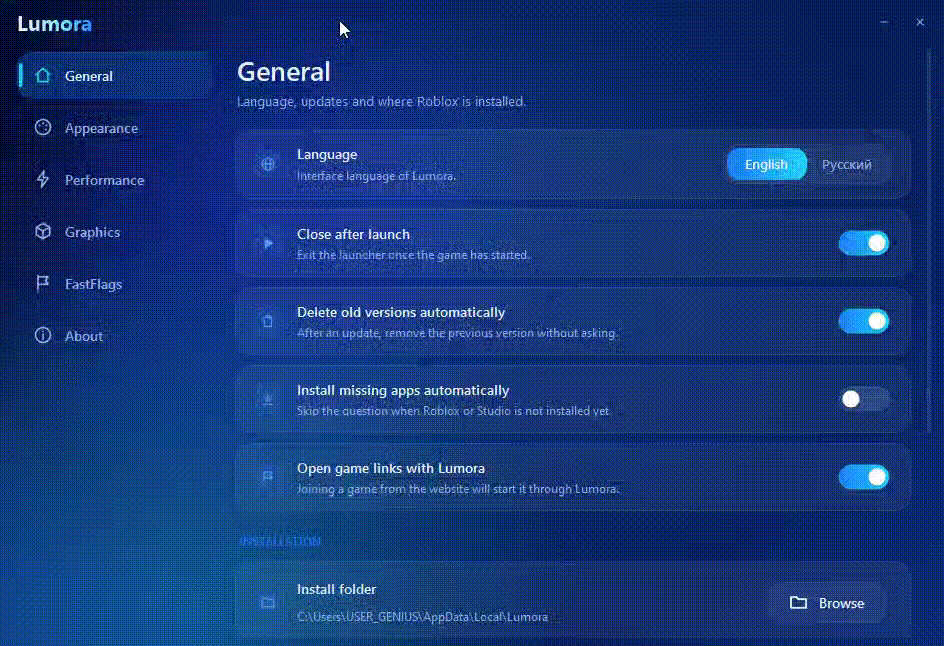

::: {align="center"}
{=html}

# ✦ LUMORA

### **Launch smarter. Play smoother.**

A sleek, lightweight launcher experience for **Roblox** and **Roblox
Studio**.

`<br>`{=html}

[](https://github.com/KefirCat/Lumorastraps/releases/latest)
[](https://github.com/KefirCat/Lumorastraps/stargazers)
[](LICENSE)

`<br>`{=html}

**Clean UI · Fast access · Your Roblox setup, simplified**
:::

------------------------------------------------------------------------

::: {align="center"}
``{=html}
``{=html}
``{=html}
:::

## ✨ What is Lumora?

**Lumora** is a modern Roblox launcher designed around one idea: make
launching and managing your Roblox experience feel effortless.

No clutter. No confusing layout. Just a polished interface that puts the
essentials within reach.

> 🚀 **Launch smarter. Play smoother.**

## 🖼️ Preview

::: {align="center"}
  ---------------------------------------------------------------------------------------------------------------------------------------------------------------------------------------
                                         **Home**                                                                                  **Settings**
  --------------------------------------------------------------------------------------- -----------------------------------------------------------------------------------------------
   ``{=html}   ``{=html}

                         *Quick launch, right where you need it.*                                                         *Make Lumora feel like yours.*
  ---------------------------------------------------------------------------------------------------------------------------------------------------------------------------------------
:::

```{=html}
<details>
```
```{=html}
<summary>
```
`<b>`{=html}🎬 Add a preview GIF (optional)`</b>`{=html}
```{=html}
</summary>
```
Place a short screen recording at `assets/lumora-preview.gif`, then
replace this section with:

``` html

```

A short, smooth recording of the home screen → settings → launch flow
works best.

```{=html}
</details>
```
## 💎 Features

```{=html}
<table>
```
```{=html}
<tr>
```
```{=html}
<td width="50%">
```
### 🚀 One-click launch

Launch **Roblox** or **Roblox Studio** directly from Lumora.

```{=html}
</td>
```
```{=html}
<td width="50%">
```
### 🎨 Modern interface

A dark blue interface with glowing cyan accents, smooth cards, and a
clean layout.

```{=html}
</td>
```
```{=html}
</tr>
```
```{=html}
<tr>
```
```{=html}
<td width="50%">
```
### ⚙️ Personalization

Choose your interface language and configure launcher behavior.

```{=html}
</td>
```
```{=html}
<td width="50%">
```
### 🧩 Smart settings

Manage launch behavior, automatic cleanup, missing-app handling, and
game links.

```{=html}
</td>
```
```{=html}
</tr>
```
```{=html}
<tr>
```
```{=html}
<td width="50%">
```
### 🖥️ Graphics

A dedicated place for graphics-related launcher options.

```{=html}
</td>
```
```{=html}
<td width="50%">
```
### ⚡ Performance & FastFlags

Performance and FastFlags sections for supported configuration options.

```{=html}
</td>
```
```{=html}
</tr>
```
```{=html}
</table>
```
## 📦 Installation

### 1. Download Lumora

::: {align="center"}
[](https://github.com/KefirCat/Lumorastraps/releases/latest)
:::

1.  Open the **[Latest
    Release](https://github.com/KefirCat/Lumorastraps/releases/latest)**
    page.
2.  Download the installer or archive attached to the release.
3.  Run it and follow the setup instructions.
4.  Open Lumora and launch Roblox or Roblox Studio.

> **Note:** Only download Lumora from this repository's official
> Releases page.

### 2. Run from source

If you want to build Lumora yourself:

``` bash
# Clone the repository
git clone https://github.com/KefirCat/Lumorastraps.git

# Enter the project directory
cd Lumora

# Install dependencies and run/build
# Replace these commands with your project's actual package manager and scripts.
```

> 🛠️ **Build instructions:** Add the exact commands for your framework
> here (for example, the commands from your package.json,
> requirements.txt, or build configuration).

## 🛠️ Configuration

Lumora currently includes these settings:

  -----------------------------------------------------------------------
  Setting                             Description
  ----------------------------------- -----------------------------------
  **Language**                        Switch the launcher interface
                                      between English and Russian.

  **Close after launch**              Close Lumora after the game starts.

  **Delete old versions               Remove previous versions after an
  automatically**                     update.

  **Install missing apps              Configure handling for missing
  automatically**                     Roblox components.

  **Open game links with Lumora**     Route supported game links through
                                      the launcher.

  **Install folder**                  View or change Lumora's
                                      installation location.
  -----------------------------------------------------------------------

## 🗺️ Roadmap

-   [x] Modern launcher home screen
-   [x] Roblox and Roblox Studio launch buttons
-   [x] General settings page
-   [x] English / Russian interface options
-   [ ] Add polished in-app animations
-   [ ] Publish complete installation and build instructions
-   [ ] Add more screenshots and a short preview GIF
-   [ ] Document Graphics, Performance, and FastFlags options
-   [ ] Add release notes and troubleshooting documentation

> Update this checklist as features ship. Keep it honest---only mark
> completed items that are actually available.

## ❓ FAQ

```{=html}
<details>
```
```{=html}
<summary>
```
`<b>`{=html}Is Lumora affiliated with Roblox?`</b>`{=html}
```{=html}
</summary>
```
No. Lumora is an independent community project and is not affiliated
with, endorsed by, or sponsored by Roblox Corporation.

```{=html}
</details>
```
```{=html}
<details>
```
```{=html}
<summary>
```
`<b>`{=html}Where can I download Lumora?`</b>`{=html}
```{=html}
</summary>
```
Use the official [GitHub
Releases](https://github.com/KefirCat/Lumorastraps/releases/latest) page.
Replace the placeholder repository link before publishing this README.

```{=html}
</details>
```
```{=html}
<details>
```
```{=html}
<summary>
```
`<b>`{=html}Roblox does not launch. What should I do?`</b>`{=html}
```{=html}
</summary>
```
-   Confirm Roblox is installed and can launch normally.
-   Check that Lumora points to the correct installation folder.
-   Restart Lumora and try again.
-   If the issue persists, open a [GitHub
    Issue](https://github.com/KefirCat/Lumorastraps/issues) and include
    your Windows version and the steps to reproduce it.

```{=html}
</details>
```
## 🐛 Support & Issues

Found a bug, have an idea, or want to request a feature?

-   **Bug reports:** [Open an
    issue](https://github.com/KefirCat/Lumorastraps/issues)
-   **Feature requests:** [Suggest an
    idea](https://github.com/KefirCat/Lumorastraps/issues)
-   **Community:** #?

Please include a clear description and screenshots when possible.

## 🤝 Contributing

Contributions, suggestions, and feedback are welcome!

1.  Fork the repository.
2.  Create a branch: `git checkout -b feature/your-feature`
3.  Make your changes.
4.  Test them.
5.  Open a pull request with a short explanation.

Please keep pull requests focused and avoid submitting untested changes.

## ⚖️ Disclaimer

Lumora is an independent launcher project. **Roblox** and **Roblox
Studio** are trademarks of Roblox Corporation. All product names, logos,
and brands are property of their respective owners.

Use Lumora at your own discretion. This project does not claim to
provide Roblox account advantages or guarantee performance improvements.

## 💙 Support the project

If Lumora is useful to you, consider giving the repository a ⭐

::: {align="center"}
[](https://github.com/KefirCat/Lumorastraps)

`<br>`{=html}

### **LUMORA**

*Launch smarter. Play smoother.*

`<sub>`{=html}Made with 💙 for the Roblox community`</sub>`{=html}
:::
